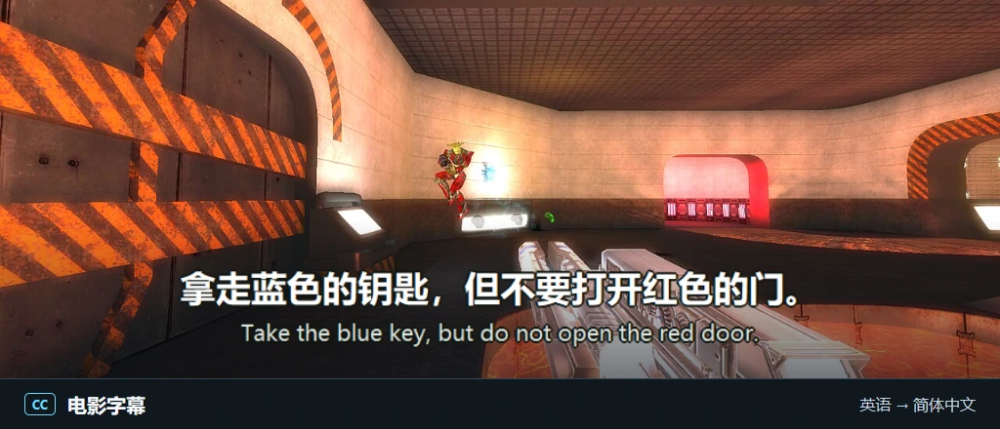
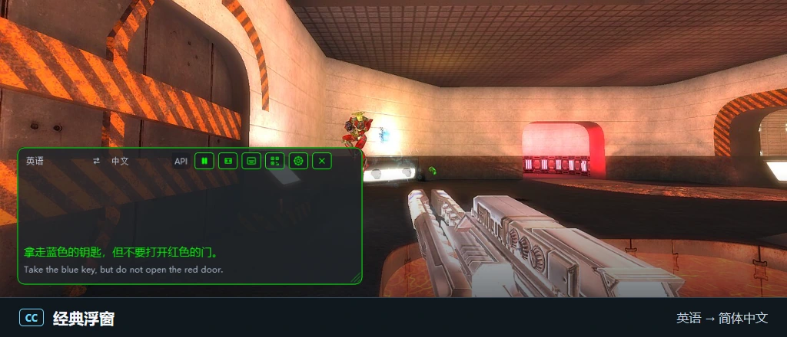

#  VoxGo · 语音实时翻译

看外语剧情、听队友报点时，VoxGo 会把原文和译文实时显示在游戏画面上。在 Windows 11 上，还可以单独选择游戏或 Discord 的声音。

**[下载 Windows 版](https://voxgo.cn/#download)**　·　[更新日志](https://voxgo.cn/changelog/)　·　[English](README_EN.md)

**电影字幕**适合看剧情，译文在上，原文在下。按 `Ctrl+Alt+M` 可切换回默认的**经典浮窗**，翻看刚才错过的队友报点。

看看同一句话在经典浮窗里的样子

## 看到第一句字幕

1. **下载并解压。** 大多数玩家选 **Lite**，解压后双击 `VoxGo.exe`，按提示下载识别模型。**Full** 内置识别模型，**Full-CUDA** 还带有 NVIDIA 显卡所需的 CUDA 运行库。
2. **选翻译方式。** 英中双向可选「本地离线翻译」，下载翻译模型并测试。使用在线服务时，填入自己的 API Key 并测试连接。
3. **播放一句对白。** 在向导里选正在用的耳机、扬声器或指定应用，播放语音，看到音量条跳动后完成向导。等模型就绪，在浮窗选好原文和译文语言，再播放一句。

**没看到字幕？** 打开「设置 → 帮助与反馈 → 自动检测」，在所选应用里再播放一句语音。独占全屏下看不到浮窗时，可先试试无边框窗口。[故障排除](docs/guide.md#故障排除)

## 语言与隐私

- **离线**支持英语 ↔ 中文（普通话）。识别和翻译都在电脑上完成，模型准备好后无需联网或 API Key。
- **在线**支持中、英、日、韩、俄互译，共 20 个方向。Whisper 在本机识别语音，文字交给你配置的翻译服务。日、韩、俄为 Beta。

基础使用统计始终开启，详细统计可在设置中关闭。两者均不上传语音、字幕或 API Key。[使用统计与隐私](docs/guide.md#使用统计与隐私)

## 指南与贡献

[使用指南](docs/guide.md) · [API 与模型配置](docs/guide.md#翻译服务与配置) · [从源码运行](docs/guide.md#从源码运行) · [反馈问题](https://github.com/zxbb1190/VoxGo_game_voice_trans/issues) · [社区](https://voxgo.cn/#community)

欢迎提交 Issue 或 Pull Request。首屏演示将 Windows 字幕截图叠加在《Xonotic》游戏画面上。[画面来源与授权](docs/guide.md#演示画面)

## 许可证与联系

本社区版项目采用 GNU General Public License v3.0，详见 [LICENSE](LICENSE)。

如需闭源商业使用、私有定制发行或商业版授权，请另行取得授权。

邮箱：[douyaj33@gmail.com](mailto:douyaj33@gmail.com)
