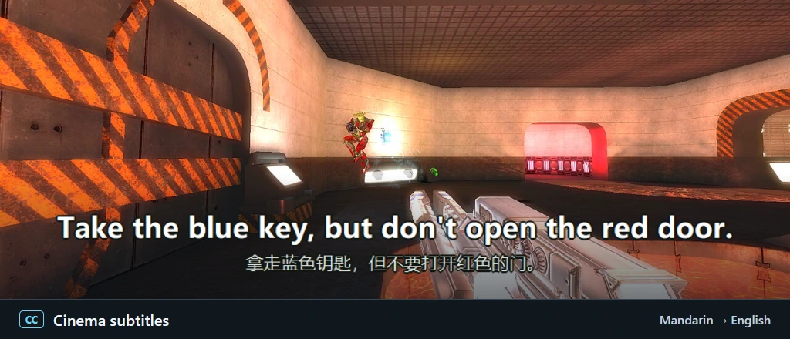
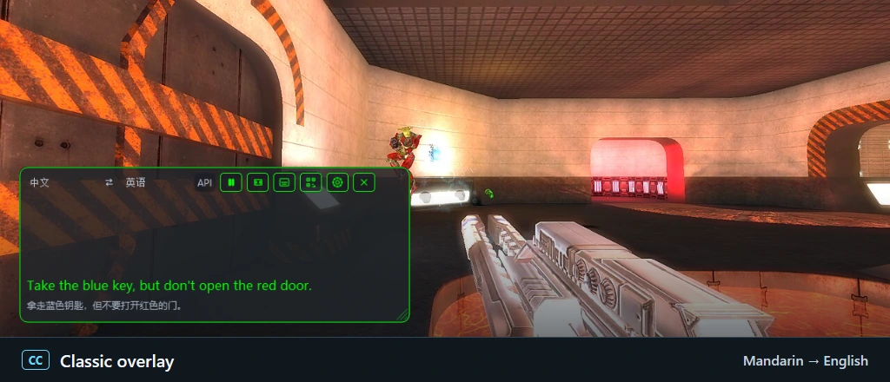

#  VoxGo · Real-time speech translation

Follow a cutscene or a teammate’s callout with bilingual subtitles over your game. On Windows 11, you can capture audio from just the game or Discord.

**[Download for Windows](https://voxgo.cn/en/#download)** · [Release notes](https://github.com/zxbb1190/VoxGo_game_voice_trans/releases) · [简体中文](README.md)

**Cinema subtitles** keep the translation above the original during cutscenes. Press `Ctrl+Alt+M` to switch back to the default **classic overlay** and scroll back to a callout you missed.

See the same line in the classic overlay

## Get your first subtitle

1. **Download and unzip.** Start with **Lite** and run `VoxGo.exe`. It downloads the speech recognition model on first use. Choose **Full** to get the speech models in the archive, or **Full-CUDA** to get the NVIDIA GPU runtime as well.
2. **Choose a translator.** For offline English ↔ Chinese, select **Offline Translation**, download the translation models and run the test. For online translation, enter your provider’s API key and test the connection.
3. **Play a line of dialogue.** In setup, select your headphones, speakers or a specific app. Play some speech, check that the level meter moves and finish setup. Once the model is ready, choose the source and subtitle languages in the overlay and play another line.

**No subtitles?** Open **Settings → Help & Feedback → Automatic diagnostics** and play a line in the selected app. If exclusive fullscreen hides the overlay, try borderless windowed mode. [Troubleshooting](docs/en/guide.md#troubleshooting)

## Languages and privacy

- **Offline** supports English ↔ Mandarin Chinese. Recognition and translation run on your PC. Once the models are ready, you can translate without an internet connection or API key.
- **Online** supports 20 directions across Chinese, English, Japanese, Korean and Russian. Whisper transcribes on your PC and sends the text to your chosen translation provider. Japanese, Korean and Russian are in beta.

Basic usage statistics are always on. You can turn off detailed statistics in Settings. Neither includes audio, subtitles or API keys. [Usage statistics and privacy](docs/en/guide.md#usage-statistics-and-privacy)

## Guides and contributions

[User guide](docs/en/guide.md) · [API and model settings](docs/en/guide.md#translation-and-configuration) · [Run from source](docs/en/guide.md#run-from-source) · [Report an issue](https://github.com/zxbb1190/VoxGo_game_voice_trans/issues) · [Community](https://voxgo.cn/en/#community)

Issues and pull requests are welcome. The VoxGo community edition uses [GPL-3.0](LICENSE). The demo pairs VoxGo subtitle captures from Windows with a Xonotic gameplay still. [Image credits and license](docs/en/guide.md#demo-image-credits)

